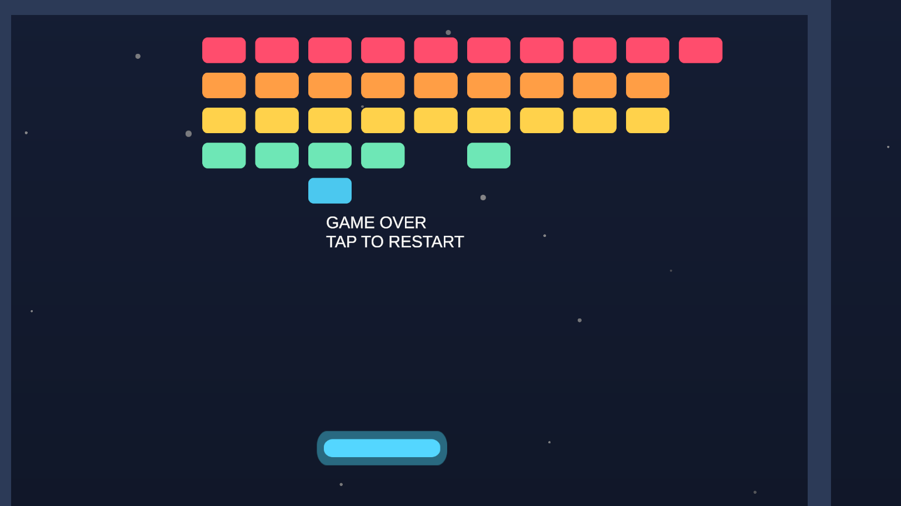

# Breakout · Unity 2D 打砖块

一个用 **Unity 6 + C#** 从零手写的 2D 打砖块小游戏。核心玩法、物理反弹、计分与生命系统全部自己实现，无第三方素材依赖（贴图由代码在运行时生成）。

> 项目定位：游戏客户端方向的练手项目，用来练「引擎基础 + C# 编程 + 打包发布」这一整条链路。

## 🎮 在线试玩

**<https://dlwhccy.github.io/Fist-project/>**

手机或电脑浏览器直接打开就能玩，无需下载安装。

| 平台 | 获取方式 |
|---|---|
| 网页版（手机/电脑） | 上面的链接，或仓库 `docs/` 目录（Unity WebGL 构建） |
| Windows 版 | Unity 中 `Build → Windows x64` 构建后可执行文件 |



## 玩法

- 鼠标拖动 或 键盘 `A` / `D`（`←` `→`）移动挡板
- 小球撞碎砖块得分，全部撞完获胜
- 球掉出底部扣 1 条命，共 **3 条命**
- 失败 / 胜利后按 `R` 重开

## 技术要点

| 模块 | 实现 |
|---|---|
| **球体运动** | `Rigidbody2D.linearVelocity` 驱动，而不是直接改 `transform.position` —— 这样才受物理引擎的碰撞响应控制 |
| **弹性反弹** | `PhysicsMaterial2D`（`Bounciness = 1`, `Friction = 0`），附加到球的 `CircleCollider2D` |
| **碰撞检测** | `OnCollisionEnter2D(Collision2D)`，靠 `collision.gameObject.name` 区分砖块/挡板/墙 |
| **输入** | 新输入系统 `Keyboard.current` / `Pointer.current`，同时兼容键鼠与触摸拖动 |
| **帧率无关移动** | 所有位移乘 `Time.deltaTime`，30fps 和 144fps 下手感一致 |
| **状态管理** | `gameOver` 标志位控制游戏循环，`SceneManager.LoadScene` 实现重开 |
| **相机适配** | 根据窗口宽高比动态调整 `Orthographic Size`，不同屏幕比例不变形 |
| **计分 UI** | TextMeshPro 富文本（`<color>` 标签）双色显示分数与生命 |
| **打包** | `Editor/BuildCLI.cs` 提供命令行构建入口（Windows x64 / WebGL） |

## 目录结构

```
Assets/
├── Scenes/SampleScene.unity    # 主场景
├── Scripts/
│   ├── PlayerMove.cs           # 球：物理驱动 + 计分 + 生命 + 重开
│   ├── PaddleMove.cs           # 挡板：键盘 + 触摸拖动
│   ├── GameSetup.cs            # 运行时布景（相机适配、关卡生成）
│   ├── Theme.cs                # 配色 + 运行时生成 Sprite
│   ├── Fx.cs                   # 撞砖块的粒子爆散
│   ├── Fragment.cs             # 碎片行为
│   └── Sfx.cs                  # 代码合成的音效
└── Editor/BuildCLI.cs          # 命令行打包入口
```

## 如何运行

**直接玩**：下载 Release 里的 `Breakout.zip`，解压后双击 `Breakout.exe`。

**自己编译**：

1. Unity **6000.6.9f1**（Unity 6.6），2D (URP) 模板
2. 打开项目 → 打开 `Assets/Scenes/SampleScene.unity` → 按 Play
3. 命令行打包：`Unity.exe -batchmode -quit -projectPath <路径> -executeMethod BuildCLI.BuildWindows`

## 已知问题

- 需要 **Unity 6** 才能打开（低版本会触发 API 升级）
- WebGL 版在部分浏览器上首次加载较慢（wasm 首次编译）

---

**作者**：董力炜 · 塔里木大学 计算机科学与技术 2024 级
